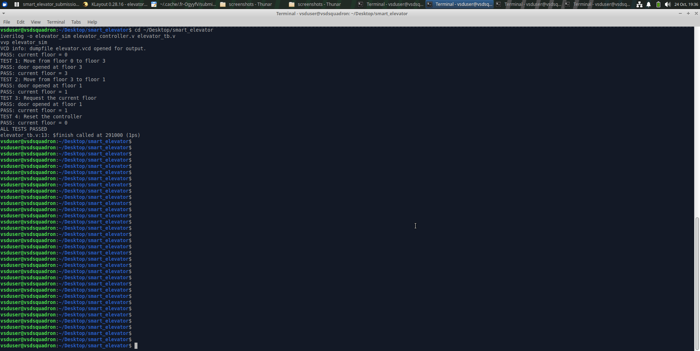
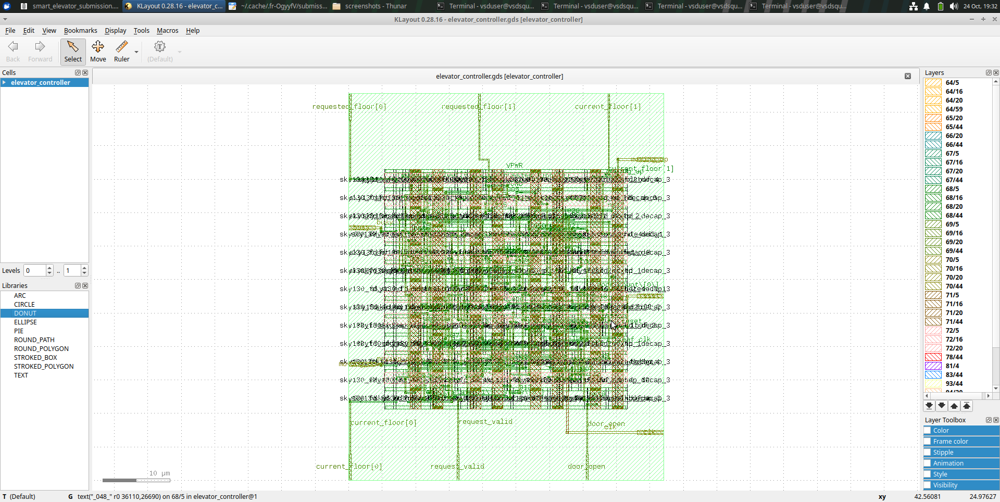
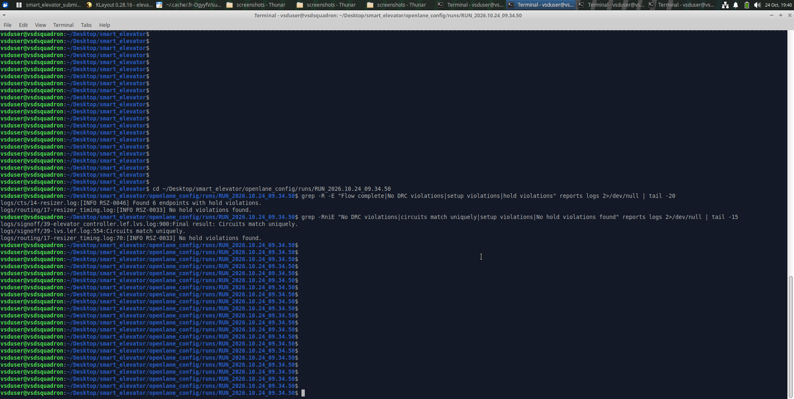

# Smart Elevator Controller — VLSI Project

## Overview
This project implements a smart elevator controller using Verilog HDL. The design was simulated and taken through an RTL-to-GDS physical-design flow using OpenLane and the Sky130 standard-cell library.

## Tools Used
- Verilog HDL
- Icarus Verilog and GTKWave
- Yosys
- OpenLane
- OpenROAD and OpenSTA
- Sky130 PDK
- KLayout

## Project Structure
- `rtl/` — Elevator controller RTL
- `tb/` — Verilog testbench
- `sim/` — Simulation results and waveforms
- `physical_design/` — Configuration and final GDS layout
- `reports/` — Final project report
- `screenshots/` — Evidence of simulation and layout
- `submission/` — Submission files and timing reports

## Verification
The testbench completed with the message `ALL TESTS PASSED`.

## Physical Design
The OpenLane flow completed successfully and generated the final GDS layout. The recorded run reported no DRC violations after GDS streaming out. The available LVS logs reported that the circuits matched uniquely. Timing reports showed positive setup and hold slack under the applied constraints.

## Main Output
`physical_design/elevator_controller.gds`

## Notes
Timing and physical verification results depend on the constraints, process corner, and tool configuration used. Review the included reports when evaluating the results.

## Verified Synthesis and Timing Results

Synthesis statistics from the OpenLane run:

- Synthesized standard-cell count: 64
- Reported synthesis chip area: 649.3728 (confirm area units from the tool/library report)
- Memory bits: 0
- Synthesis processes: 0

Placement-stage timing summary:

- Worst setup slack: +6.72 ns
- Worst hold slack: +0.24 ns
- Total negative slack (TNS): 0.00

These values are from the generated reports and apply to the reported flow stage and constraints. They do not by themselves establish full signoff or multi-corner timing closure.

## Design Specifications

| Parameter | Value |
|---|---|
| Project | Smart Elevator Controller |
| HDL | Verilog |
| Target technology | SkyWater SKY130 |
| Physical design flow | OpenLane |
| Target clock period | 10 ns (100 MHz) |
| Main design | `elevator_controller` |
| Final layout | `elevator_controller.gds` |

## Implementation Flow

1. **RTL design:** Implement the elevator controller and its control states.
2. **Functional simulation:** Run the testbench to verify controller behavior. The recorded simulation completed with `ALL TESTS PASSED`.
3. **Synthesis:** Convert the RTL into a gate-level netlist using the Sky130 standard-cell library.
4. **Floorplanning and placement:** Prepare the core and place standard cells.
5. **Clock and routing stages:** Run the configured physical-design flow.
6. **Layout generation:** Generate the GDS layout.
7. **Verification:** Review the available timing, DRC, and LVS reports.

## Reported Results

| Metric | Reported result |
|---|---|
| Synthesized standard cells | 64 |
| Reported synthesized module area | 649.3728 (tool-reported area units) |
| Target clock period | 10 ns |
| Placement-stage worst setup slack | +6.72 ns |
| Placement-stage worst hold slack | +0.23 ns |
| Total negative slack (TNS) | 0.00 |

The cell count and area are from the available synthesis statistics. Timing values are from the reported placement-stage analysis and depend on the constraints and flow stage. They should not be interpreted as proof of full signoff timing closure.

## Verification Notes

- The functional testbench completed successfully in the recorded run.
- The OpenLane run completed and generated the GDS file.
- The available signoff reports should be consulted for the exact DRC and LVS findings.
- The current timing evidence does not establish that 16 distinct timing corners have been analyzed. Multi-corner timing verification remains future work unless supported by additional reports.

## Repository Contents

- `rtl/` — RTL design files
- `tb/` — testbench files
- `sim/` — simulation-related files
- `results/` — synthesis netlists and timing constraints
- `physical_design/` — physical-design artifacts
- `reports/sta_reports/` — timing reports
- `submission/` — organized submission and verification reports
- `screenshots/` — project evidence
- `smart_elevator_final_report.pdf` — project report

## Future Improvements

- Complete and document multi-corner static timing analysis.
- Add clear screenshots of simulation waveforms and the final layout.
- Summarize DRC and LVS findings directly in the report.
- Add a short project demonstration video.

## Timing Verification

Timing summary values collected from the available OpenLane/OpenSTA reports:

| Report | Worst Setup Slack | Worst Hold Slack | TNS | WNS |
|---|---:|---:|---:|---:|
| RCX nominal summary | +5.25 ns | +0.15 ns | 0.00 | 0.00 |
| RCX summary | +6.41 ns | +0.39 ns | 0.00 | 0.00 |

These values are copied from the report output available for this project. Results apply to the corresponding reported flow stage and constraints; they do not by themselves establish complete signoff across every process-voltage-temperature corner.

---

## Visual Results

### RTL Simulation
The functional testbench completed successfully with `ALL TESTS PASSED`.

### Physical Layout
The generated GDSII layout is available in `physical_design/elevator_controller.gds`.

### Physical Design Result
The OpenLane flow completed and generated the layout. Refer to the included verification reports for the recorded results.

## Final Results Summary

| Metric | Recorded Result |
|---|---|
| Functional simulation | ALL TESTS PASSED |
| Top module | `elevator_controller` |
| Target technology | SkyWater SKY130 |
| Physical design flow | OpenLane |
| Synthesis cell count | 64 |
| Reported synthesis area | 649.3728 tool-reported units |
| Placement setup slack | +6.72 ns |
| Placement hold slack | +0.24 ns |
| Placement TNS | 0 |
| DRC | Zero violations reported in available final report |
| LVS | See included LVS report |
| GDSII | Generated |

*Timing values are from the specified implementation reports and constraints. They do not establish complete multi-corner or full PVT signoff.*

## Challenges and Solutions

- **Functional verification:** Used a Verilog testbench to check elevator-controller behavior.
- **Physical implementation:** Used OpenLane to run the RTL-to-GDS flow.
- **Timing verification:** Reviewed setup and hold timing reports and recorded the reported slack values.
- **Layout verification:** Reviewed the available DRC and LVS reports.
- **Reproducibility:** Retained RTL, testbench, configuration, layout, and verification reports in the project.

## Limitations and Future Work

- Complete and document the required multi-corner static timing analysis.
- Confirm the exact process corners and constraints associated with each timing report.
- Review and document any warnings or limitations in the final LVS report.
- Add further annotated screenshots and a project demonstration video.
- Include power estimates only after validating the corresponding power report.

## Project Artifacts

- RTL: `elevator_controller.v`
- Testbench: `elevator_tb.v`
- GDSII layout: `physical_design/elevator_controller.gds`
- OpenLane configuration: `openlane_config/`
- Verification reports: `submission/verification_reports/`
- Submission checklist: `submission/FINAL_SUBMISSION_CHECKLIST.md`
- Final report PDF: `smart_elevator_final_report.pdf`

